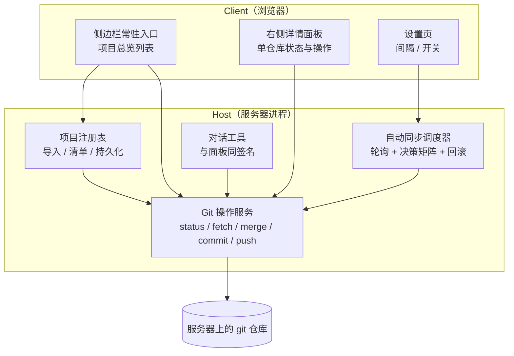

# git-sentry 方案计划书

| 项 | 内容 |
| --- | --- |
| 文档版本 | v1.0 |
| 定稿时间 | 2026-10-14 |
| 前置阅读 | `requirements.md`、`decisions.md`（本文大量引用 `D-xx` 编号） |

---

## 1. 总体架构

本插件是一个 **DSH bundle**，同时包含 Host 侧（服务器进程，负责真正的 git 操作）
和 Client 侧（浏览器，负责界面）。



| 模块 | 职责 | 对外接口 |
| --- | --- | --- |
| 项目注册表 | 导入项目、校验是否 git 仓库、维护持久化清单 | `listProjects` / `importProjects` / `removeProject` |
| Git 操作服务 | 统一执行所有 git 命令：argv 传参、非交互、超时、同仓库串行 | `gitStatus` / `gitPull` / `gitCommit` / `gitPush` |
| 自动同步调度器 | 按间隔轮询，执行决策矩阵，失败回滚 | 定时器内部驱动，不直接对外 |
| 对话工具 | 把上述能力暴露给对话，参数与语义和按钮完全一致 | 与 Git 操作服务同签名 |
| 侧边栏总览 | 全项目一览、状态与快捷操作 | slot `sidebar.panellist` |
| 右侧详情面板 | 单仓库详情、待合入提交、冲突文件、提交表单 | slot `sidebar.right.pane.tab` |
| 设置页 | 轮询间隔、逐项目开关、自动创建远程分支开关 | slot `settings.section` + 插件 Config |

## 2. 实现形态与安装

| 项 | 做法 | 依据 |
| --- | --- | --- |
| 包目录 | 独立目录 `/home/tokamak/dev/repos/git-sentry` | `D-21` |
| 安装 | 用 DSH 的插件管理器，以**绝对路径**把包目录安装进 profile | `D-21` |
| profile | `/home/tokamak/.dsh/profiles/web` | 已实测 |
| 禁止 | 不修改 profile 的 `package.json`、不在 profile 目录跑包管理命令 | `D-21`、`NFR-07` |
| 生效方式 | 客户端 bundle 变更后**需要刷新浏览器页面**才能看到 | — |

骨架文件（已就位）：

| 文件 | 作用 |
| --- | --- |
| `package.json` | 包声明 + `dsh.bundle.patch` + `dsh.client` 元数据 |
| `cordis.patch.yml` | 挂载入口，`id: git-sentry`，`name: @local/git-sentry` |
| `index.js` | Host 侧入口，导出 `apply` |
| `client.js` | 浏览器侧入口，注册 `@local/git-sentry` 工厂 |
| `locale/zh.json`、`locale/en.json` | 文案 |
| `icon.svg` | 图标 |

## 3. 数据模型

每个已导入项目一条记录，持久化在 **Host 侧**（`D-08`）：

```ts
ProjectRecord {
  id:           string          // 稳定标识
  path:         string          // 服务器上的绝对路径
  name:         string          // 显示名
  syncSource:   string          // 默认 'origin/HEAD'      —— D-10
  pushTarget:   string          // 默认 'origin/<branch>'  —— D-11
  autoSync:     boolean         // 默认 false
  addedAt:      string          // ISO 时间
  lastSync?: {
    at:            string
    result:        'up-to-date' | 'merged' | 'skipped' | 'conflict' | 'unreachable'
    detail?:       string
    conflictFiles?: string[]
  }
}
```

存储载体：Host 侧的键值存储（`ctx.storage` 是**可选服务**，取用时要处理 `undefined`，
并提供降级路径）。

> 客户端**不另存一份**（`D-08`）。面板上的所有状态都来自 Host 的查询结果。

## 4. 接口设计

Host 侧一组服务方法，**同一个实现**同时服务面板按钮和对话工具（`D-15`）：

| 方法 | 语义 | 对应 UI |
| --- | --- | --- |
| `listProjects()` | 返回全部项目的当前状态快照 | 主面板 |
| `importProjects(paths)` | 校验并写入清单 | 导入按钮 |
| `removeProject(id)` | 从清单移除（**不删磁盘仓库**） | 详情面板 |
| `gitStatus(id)` | 单仓库状态：分支、同步来源、推送目标、领先落后、脏标记 | 主面板行 + 详情面板 |
| `gitPull(id)` | 从 `syncSource` 合入当前分支 | 拉取按钮 |
| `gitCommit(id, message)` | 全量提交，返回将提交的文件清单 | 提交表单 |
| `gitPush(id)` | 推送到 `pushTarget` | 推送按钮 |
| `getSettings()` / `setSettings()` | 读 / 写插件配置 | 设置页 |

**约定**：方法的参数与语义在"面板按钮"和"对话工具"两侧必须完全一致。
不允许出现"按钮做的和工具有做的不是一回事"。

## 5. 界面设计

### 5.1 侧边栏常驻入口

一个图标，带未读样式，点击打开/收起主面板。

### 5.2 主面板（项目总览）

```
[ 演示数据 ]
──────────────────────────────────────
ArtPass            MintDev      ↑2 ↓5   ●3    [⟳] [✓] [↑]   [自动同步 ○]
DogEar             main         ↑0 ↓0   干净   [⟳] [✓] [↑]   [自动同步 ●]
dutybot            main         ↑1 ↓0   ●1    [⟳] [✓] [↑]   [自动同步 ○]
VibeCodingPack     main         拉取失败       [⟳] [✓] [↑]   [自动同步 ○]
──────────────────────────────────────
```

每行：项目名 / 当前分支 / 领先落后 / 脏标记 / 拉取·提交·推送 / 逐项目自动同步开关。

### 5.3 右侧详情面板

| 区块 | 内容 |
| --- | --- |
| 状态摘要 | 分支、**同步来源**、**推送目标**、领先落后、最后同步时间 |
| 待合入提交 | fetch 后的提交列表：作者、标题、时间 |
| 冲突文件 | 仅冲突时出现，列出具体文件与处理说明 |
| 提交表单 | 提交信息输入框 + **将要提交的文件清单**（`D-13`） |
| 推送 | 推送按钮，推送前二次确认（`D-20`） |
| 同步记录 | 最近若干次同步结果与原因 |

> 状态摘要里 `同步来源` 与 `推送目标` **必须分两栏显示**（`D-09`）。
> 这样用户一眼就能看出"正在跟谁同步、会推到哪里"，跟错来源或推错目标不再需要靠记忆避免。

### 5.4 设置页

| 配置项 | 默认 |
| --- | --- |
| 轮询间隔 | 60 秒（`D-06`） |
| 逐项目自动同步 | 关 |
| 推送时若远程无同名分支则自动创建 | 开（`D-12`） |

### 5.5 浮层约束（P1 原型的关键技术点）

DSH 插件规则**禁止往自己组件之外写 DOM**，不能 `.append()` 到 `document.body`。
因此提示浮层**只能渲染在插件自己的面板容器内部**，位置固定在面板内右下角，
**无法做成全局 toast，也无法跟随鼠标或页面居中弹出**。

第一期所有未实现的操作统一收敛到这一个浮层：点任何按钮都显示
"该操作将来会做什么"，不假装成功、不静默无反应。

## 6. 自动同步决策矩阵

核心逻辑（`D-02` ~ `D-05`）：

| 场景 | 判定依据 | 插件行为 |
| --- | --- | --- |
| 无新提交 | fetch 后上游与本地一致 | 什么都不做，仅更新时间戳 |
| 未提交改动与上游不重叠 | `merge` 成功 | 完成更新，用户改动原样保留 |
| 未提交改动与上游落在同一文件 | git 拒绝合并，工作区与索引**零变化** | 仅提示：指出具体文件，等用户处理 |
| 会冲突 | `merge-tree --write-tree` 退出码 1 | 仅提示冲突文件，**不动工作区** |
| 预判无冲突但实际冲突 | merge 后产生冲突 | 立即 `merge --abort` 回滚，再提示 |
| fetch 失败（网络 / 凭据） | 非零退出码 | 记为失败，面板标红，下一轮重试 |
| 同一仓库正被手动操作 | 仓库锁被占用 | **跳过本轮**，不排队、不抢占（`NFR-03`） |

### 无法两全的边界

当用户的未提交改动与上游改动**落在同一文件**时，**不存在**既能保留改动、又能完成更新的自动方案。
此时唯一正确的做法是停下来告诉用户具体是哪个文件。**不要用 `stash` 或 `checkout` 去"帮忙解决"**
（`D-20`）。

### 兼容性降级

`merge-tree --write-tree` 需要 **git ≥ 2.38**。服务器当前为 **2.43.0**，满足。
但插件不应假设环境：低版本时降级为**只判断能否 fast-forward**，非快进一律仅提示，
不做预判也不自动合并。

## 7. 工程保障

| 项 | 做法 | 依据 |
| --- | --- | --- |
| argv 传参 | 所有 git 调用以参数数组形式发起，**不拼 shell 字符串** | 避免路径/分支名注入 |
| 非交互 | `GIT_TERMINAL_PROMPT=0`、`GIT_SSH_COMMAND="ssh -o BatchMode=yes -o ConnectTimeout=15"` | `NFR-01` |
| 硬超时 | 每次调用带超时，超时即强制终止子进程并记为失败 | `NFR-02` |
| 同仓库串行 | 每仓库一把锁 | `NFR-03` |
| 失败隔离 | 单项目异常不中断整轮刷新 | `NFR-04` |
| 回滚 | 合并产生冲突时 `merge --abort` | `NFR-05` |
| 输出稳定 | 固定 `LC_ALL=C`，避免本地化消息影响解析 | 工程建议 |

## 8. 分期计划

### P1 —— 纯 UI 原型（**下一步**，`D-19`）

**目标**：让用户在浏览器里看到并点到界面，先定形状，再填逻辑。

| 交付物 | 内容 |
| --- | --- |
| 侧边栏常驻入口 | 图标，点击打开/收起主面板 |
| 主面板 | 示例项目行：名称、分支、领先落后、脏标记、自动同步开关、三个按钮 |
| 右侧详情面板 | 状态摘要、待合入提交、冲突文件区、提交表单、推送按钮、同步记录 |
| 设置页 | 三个配置项，控件可真实操作但不落盘 |
| 统一提示浮层 | 所有未实现操作点击后显示"将来会做什么" |

**边界（必须在界面上说清楚）**：不读 git、不存数据、不装定时器、刷新后状态回到初始值。
示例数据用真实目录名，但状态值是编的，界面标注"演示数据"徽标。

**验收**：见 `requirements.md` §7.1。

### P2 —— 自动同步

- 实现项目注册表与 `ctx.storage` 持久化
- 实现 Git 操作服务（`git status` / `fetch` / `merge` / `commit` / `push`）
- 实现决策矩阵与轮询调度器
- 接入设置页（间隔、逐项目开关、自动创建远程分支开关）
- 把同步结果做成可订阅事件点（`D-18`）

**验收**：见 `requirements.md` §7.2。

### P3 —— 增强（待议）

候选：Webhook 触发替代部分轮询、提交历史、diff 预览、分支切换、批量操作。
**这些尚未与用户确认，动手前必须先问。**

## 9. 风险登记

| 编号 | 风险 | 影响 | 缓解 / 现状 |
| --- | --- | --- | --- |
| **RK-01** | 自动合并与用户正在编辑文件之间存在竞争 | 合并可能让文件在用户眼前变动 | **已知取舍**：暂不加"静默期"规避，因为那会引入新的判断复杂度。用户已知悉。若实际使用中造成困扰，再评估 |
| **RK-02** | 凭据失效导致 fetch 挂起 | 服务器上会挂死 | `NFR-01` 非交互 + `NFR-02` 硬超时。**当前凭据是 `gh auth git-credential`，其刷新行为需要实测确认** |
| **RK-03** | 脏工作区与上游撞同一文件 | 无法自动完成 | 这是**无法两全的边界**，只能提示（见 §6）。已如实告知用户 |
| **RK-04** | 全量提交误纳新文件 | 误提交 `.env`、日志、临时文件 | `D-13` 提交前列清单 |
| **RK-05** | 自动创建远程分支时分支名打错 | 远程多出垃圾分支 | `D-12` 提供开关，可关闭改为手动确认 |
| **RK-06** | git 版本低于 2.38 时预判失效 | 失去冲突预判 | §6 兼容性降级；当前 2.43 不触发 |
| **RK-07** | 大仓库 `git status` 慢 | 面板刷新卡顿 | 逐项目独立查询 + 失败隔离；必要时加结果缓存 |
| **RK-08** | 浮层位置受限 | 用户可能期待全局 toast | §5.5 已提前说明；若必须全局，需单独讨论实现方式 |

## 10. 未决项

设计与需求层面**已无未决项**——21 条决策全部确认，见 `decisions.md`。

仅有的开放内容是 **P3 的范围**（§8），它需要在 P2 完成后重新与用户讨论。
