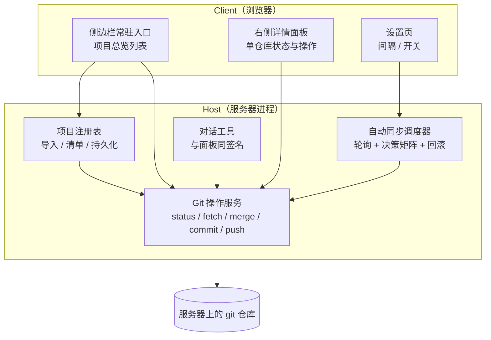

# git-sentry 方案计划书

| 项 | 内容 |
| --- | --- |
| 文档版本 | v1.0 |
| 定稿时间 | 2026-10-14 |
| 前置阅读 | `requirements.md`、`decisions.md`（本文大量引用 `D-xx` 编号） |

---

## 1. 总体架构

本插件是一个 **DSH bundle**，同时包含 Host 侧（服务器进程，负责真正的 git 操作）
和 Client 侧（浏览器，负责界面）。



| 模块 | 职责 | 对外接口 |
| --- | --- | --- |
| 项目注册表 | 导入项目、校验是否 git 仓库、维护持久化清单 | `listProjects` / `importProjects` / `removeProject` |
| Git 操作服务 | 统一执行所有 git 命令：argv 传参、非交互、超时、同仓库串行 | `gitStatus` / `gitPull` / `gitCommit` / `gitPush` |
| 自动同步调度器 | 按间隔轮询，执行决策矩阵，失败回滚 | 定时器内部驱动，不直接对外 |
| 对话工具 | 把上述能力暴露给对话，参数与语义和按钮完全一致 | 与 Git 操作服务同签名 |
| 侧边栏总览 | 全项目一览、状态与快捷操作 | slot `sidebar.panellist` + 主区 `main` |
| 右侧详情面板 | 单仓库详情、待合入提交、冲突文件、提交表单 | slot `sidebar.right.pane.tab` |
| 设置页 | 轮询间隔、逐项目开关、自动创建远程分支开关 | slot `settings.section`；读写接口 `getSettings` / `setSettings`（**插件 Config，设置的唯一数据源**） |

### 5.1 slot 落点实测结论（2026-10-14，已用 `Slots.listSubTree` 核对）

`sidebar.panellist` **只是图标栏，不是内容区**，不能承载总览列表。实测形状：

| slot | kind / scope | register 选项 | 传给组件的 owner props |
| --- | --- | --- | --- |
| `sidebar.panellist` | `list` / root | `id`、`order`、`label` | `{ size, active }` —— 仅几何与选中态 |
| `main` | `keyed` / root | `key` | 无 owner props；key 与 `sidebar.panellist` 的 `id` 对应 |
| `sidebar.right.pane.tab` | `keyed` / **session** | `key` | 无 owner props；key 须由一个 tab 类型定义 dispatch |
| `settings.section` | `list` / root | `id`、`order`、`label` | `{ close }` |

补充实测：侧边栏全部洞位（`ui-sidebar/src/client/contract/slots.ts`）

| slot | kind / scope | owner props |
| --- | --- | --- |
| `sidebar.toggle.badge` | `single` / root | 无（折叠按钮内非交互徽标） |
| `sidebar.workspaces` | `single` / root | `{ wide, expandSidebar }`（已被 ui-workspace 占用） |
| `sidebar.settings` | `single` / root | `{ wide }`（已被 ui-settings 占用） |
| `sidebar.footer.action` | `list` / root | `{ wide }` —— **当前无任何注册者，空位** |

**关键约束（读 `SidebarRoot.tsx` 的 `PanelRow` 得到）**：`sidebar.panellist` 的行由宿主写死为
`panelGlyph`（`aria-hidden` 的 `size` 16/18 方形图标容器）+ label 文字，
**没有第三个插槽位**，因此它只能画图标，承载不了状态文字。

### 5.2 第一期最终落点（已与用户确认）

用户明确要求「不要左侧与主区冲突，但侧边栏上要能看到一点状态」，故选：

| 用途 | slot | 说明 |
| --- | --- | --- |
| 侧边栏状态行（常驻） | `sidebar.footer.action` | 宽态一行汇总 `4 仓库 · 1 待拉取`，**可展开**为逐仓库列表；窄态（56px）退化为图标 + 角标 |
| 主区操作台 | `main`（key `git-sentry`） | 左列表右详情的主从布局：项目行、提交表单、冲突详情 |
| 设置页 | `settings.section` | 轮询间隔、逐项目开关 |

分工：**状态常驻侧边栏（不切走就能看到是否有事），操作整页在主区（表单、详情放不进侧边栏）**。
`sidebar.panellist` **不注册**——状态行已承担入口职责，两个功能相同的入口会让用户困惑。
（这一条是装机后由用户反馈修正的：初版两个都注册了，用户看到「顶部和底部都有两个显示」。）

**不做 `sidebar.right.pane.tab`**：它由 tab 类型定义 dispatch，需额外注册 `ctx.sidebarRightTabs`
并用 `ctx.sidebarRight.openTab()` 打开，引入 tab 生命周期与跨会话持久化绑定整层复杂度，延期到 P3，
届时按 `ui-schedule` 的 `definition.ts` + `task-tab-bindings.ts` 模式补。

**RK-10 的真实化解**：原 §5 线框图假定的「侧边栏常驻总览列表」在当前 slot 体系下不成立。
新增 `RK-11`：`sidebar.footer.action` 属宿主内部契约且当前无注册者，未来版本可能变化。

## 2. 实现形态与安装

| 项 | 做法 | 依据 |
| --- | --- | --- |
| 包目录 | 独立目录 `/home/tokamak/dev/repos/git-sentry` | `D-21` |
| 安装 | 用 DSH 的插件管理器，以**绝对路径**把包目录安装进 profile | `D-21` |
| profile | `/home/tokamak/.dsh/profiles/web` | 已实测 |
| 禁止 | 不修改 profile 的 `package.json`、不在 profile 目录跑包管理命令 | `D-21`、`NFR-07` |
| 生效方式 | 客户端 bundle 变更后**需要刷新浏览器页面**才能看到 | — |

骨架文件（已就位）：

| 文件 | 作用 |
| --- | --- |
| `package.json` | 包声明 + `dsh.bundle.patch` + `dsh.client` 元数据 |
| `cordis.patch.yml` | 挂载入口，`id: git-sentry`，`name: dsh-git-sentry` |
| `index.js` | Host 侧入口，导出 `apply` |
| `client.js` | 浏览器侧入口，注册 `dsh-git-sentry` 工厂 |
| `locale/zh.json`、`locale/en.json` | 文案 |
| `icon.svg` | 图标 |

## 3. 数据模型

每个已导入项目一条记录，持久化在 **Host 侧**（`D-08`）：

```ts
ProjectRecord {
  id:           string          // 稳定标识
  path:         string          // 服务器上的绝对路径
  name:         string          // 显示名
  syncSource:   string          // 默认 'origin/HEAD'      —— D-10
  pushTarget:   string          // 默认 'origin/<branch>'  —— D-11
  autoSync:     boolean         // 默认 false
  addedAt:      string          // ISO 时间
  lastSync?: {
    at:            string
    result:        'up-to-date' | 'merged' | 'skipped' | 'conflict' | 'unreachable'
    detail?:       string
    conflictFiles?: string[]
  }
}
```

存储载体：Host 侧的键值存储（`ctx.storage` 是**可选服务**，取用时要处理 `undefined`，
并提供降级路径）。

> `ctx.storage` **仅存项目清单**（`ProjectRecord`），**不存任何设置项**。设置项的单一数据源是
> **插件 Config**（见 §1、§4）。两处并存会造成双源漂移，与 `D-08` 的原则冲突。

> `syncSource` 存**解析后的实际引用**；无法解析时以显式的 `unresolved` 标记保存，
> **不留空字符串**（见 §6 决策矩阵与 `D-10`）。

> 客户端**不另存一份**（`D-08`）。面板上的所有状态都来自 Host 的查询结果。

## 4. 接口设计

Host 侧一组服务方法，**同一个实现**同时服务面板按钮和对话工具（`D-15`）：

| 方法 | 语义 | 对应 UI |
| --- | --- | --- |
| `listProjects()` | 返回全部项目的当前状态快照 | 主面板 |
| `importProjects(paths)` | 校验并写入清单 | 导入按钮 |
| `removeProject(id)` | 从清单移除（**不删磁盘仓库**） | 详情面板 |
| `gitStatus(id)` | 单仓库状态，**纯本地只读、不发起任何网络请求**：分支、同步来源、推送目标、**领先 / 落后（一律以同步来源为基准）**、**相对推送目标是否存在 / 可否快进**、脏标记、`lastFetchAt` | 主面板行 + 详情面板 |
| `gitPull(id)` | 从 `syncSource` 合入当前分支 | 拉取按钮 |
| `gitCommit(id, message)` | 全量提交，返回将提交的文件清单。**入口处预检该仓库的 `user.name` / `user.email`**，缺失即返回失败与明确原因 | 提交表单 |
| `gitPush(id)` | 推送到 `pushTarget` | 推送按钮 |
| `getSettings()` / `setSettings()` | 读 / 写插件配置（落在**插件 Config**，**不重复写入 `ctx.storage`**） | 设置页 |

**推送命令约定**：始终显式指定 remote 与 branch（`git push <remote> <branch>`），
**不附带 `-u`**——本插件不设置也不使用 upstream（见 `R-01`、`D-12`）。

**约定**：方法的参数与语义在"面板按钮"和"对话工具"两侧必须完全一致。
不允许出现"按钮做的和工具有做的不是一回事"。

## 5. 界面设计

### 5.1 侧边栏常驻入口

一个图标，带未读样式，点击打开/收起主面板。

### 5.2 主面板（项目总览）

```
[ 演示数据 ]
──────────────────────────────────────
ArtPass            MintDev      ↑2 ↓5   ●3    [⟳] [✓] [↑]   [自动同步 ○]
DogEar             main         ↑0 ↓0   干净   [⟳] [✓] [↑]   [自动同步 ●]
dutybot            main         ↑1 ↓0   ●1    [⟳] [✓] [↑]   [自动同步 ○]
VibeCodingPack     main         拉取失败       [⟳] [✓] [↑]   [自动同步 ○]
──────────────────────────────────────
```

每行：项目名 / 当前分支 / 领先落后 / 脏标记 / 拉取·提交·推送 / 逐项目自动同步开关。

### 5.3 右侧详情面板

| 区块 | 内容 |
| --- | --- |
| 状态摘要 | 分支、**同步来源**、**推送目标**、**相对推送目标（是否存在 / 可否快进）**、领先落后（**一律以同步来源为基准**）、最后 fetch 时间、最后同步时间 |
| 待合入提交 | fetch 后的提交列表：作者、标题、时间 |
| 冲突文件 | 仅冲突时出现，列出具体文件与处理说明 |
| 提交表单 | 提交信息输入框 + **将要提交的文件清单**（`D-13`） |
| 推送 | 推送按钮，推送前二次确认（`D-20`） |
| 同步记录 | 最近若干次同步结果与原因 |

> 状态摘要里 `同步来源` 与 `推送目标` **必须分两栏显示**（`D-09`）。
> 这样用户一眼就能看出"正在跟谁同步、会推到哪里"，跟错来源或推错目标不再需要靠记忆避免。

### 5.4 设置页

| 配置项 | 默认 |
| --- | --- |
| 轮询间隔 | 60 秒（`D-06`） |
| 逐项目自动同步 | 关 |
| 推送时若远程无同名分支则自动创建 | 开（`D-12`） |

### 5.5 浮层约束（P1 原型的关键技术点）

DSH 插件规则**禁止往自己组件之外写 DOM**，不能 `.append()` 到 `document.body`。
因此提示浮层**只能渲染在插件自己的面板容器内部**，位置固定在面板内右下角，
**无法做成全局 toast，也无法跟随鼠标或页面居中弹出**。

第一期所有未实现的操作统一收敛到这一个浮层：点任何按钮都显示
"该操作将来会做什么"，不假装成功、不静默无反应。

## 6. 自动同步决策矩阵

核心逻辑（`D-02` ~ `D-05`）：

| 场景 | 判定依据 | 插件行为 |
| --- | --- | --- |
| 同步来源不可解析 | `git symbolic-ref refs/remotes/origin/HEAD` 失败 | 记为 `skipped`，并**明确提示「同步来源不可解析」**；**不得当作「无新提交」**（`D-10`） |
| 无新提交 | fetch 后上游与本地一致 | 什么都不做，仅更新时间戳 |
| 未提交改动与上游不重叠 | `merge` 成功 | 完成更新，用户改动原样保留 |
| 未提交改动与上游落在同一文件 | git 拒绝合并，工作区与索引**零变化** | 仅提示：指出具体文件，等用户处理 |
| 会冲突 | `merge-tree --write-tree` 退出码 1 | 仅提示冲突文件，**不动工作区** |
| 预判无冲突但实际冲突 | merge 后产生冲突 | 立即 `merge --abort` 回滚，再提示 |
| fetch 失败（网络 / 凭据） | 非零退出码 | 记为失败，面板标红，下一轮重试 |
| 同一仓库正被手动操作 | 插件锁被占用，或 `.git/index.lock` 存在 | **跳过本轮**，不排队、不抢占（`NFR-03`）。插件**不感知**用户在服务器终端发起的操作 |

**fetch 的触发路径（仅此三条）**：自动同步轮询（`FR-07`）、用户点击「拉取」（`FR-04`）、
详情面板中用户显式点击「刷新远程状态」。`gitStatus` **自身不联网**（见 §4）。

### 无法两全的边界

当用户的未提交改动与上游改动**落在同一文件**时，**不存在**既能保留改动、又能完成更新的自动方案。
此时唯一正确的做法是停下来告诉用户具体是哪个文件。**不要用 `stash` 或 `checkout` 去"帮忙解决"**
（`D-20`）。

### 兼容性降级

`merge-tree --write-tree` 需要 **git ≥ 2.38**。服务器当前为 **2.43.0**，满足。
但插件不应假设环境：低版本时降级为**只判断能否 fast-forward**，非快进一律仅提示，
不做预判也不自动合并。

## 7. 工程保障

| 项 | 做法 | 依据 |
| --- | --- | --- |
| argv 传参 | 所有 git 调用以参数数组形式发起，**不拼 shell 字符串** | 避免路径/分支名注入 |
| 非交互 | `GIT_TERMINAL_PROMPT=0`、`GIT_SSH_COMMAND="ssh -o BatchMode=yes -o ConnectTimeout=15"` | `NFR-01` |
| 硬超时 | 每次调用带超时，超时即强制终止子进程并记为失败 | `NFR-02` |
| 同仓库串行 | 每仓库一把锁；**仅覆盖本插件发起的操作**，并把 `.git/index.lock` 存在视为忙、跳过本轮 | `NFR-03` |
| 失败隔离 | 单项目异常不中断整轮刷新 | `NFR-04` |
| 回滚 | 合并产生冲突时 `merge --abort` | `NFR-05` |
| 输出稳定 | 固定 `LC_ALL=C`，避免本地化消息影响解析 | 工程建议 |

## 8. 分期计划

### P1 —— 纯 UI 原型（**已完成，2026-10-14**）

**目标**：让用户在浏览器里看到并点到界面，先定形状，再填逻辑。

| 交付物 | 实际落点 | 状态 |
| --- | --- | --- |
| 侧边栏常驻状态行 | `sidebar.footer.action`：宽态一行汇总 + 待处理计数徽标（可点跳转）+ 可展开列表；窄态图标 + 角标 | ✅ 已实现 |
| 主区操作台 | `main`（key `git-sentry`）：左列表右详情、提交表单、冲突区、三个按钮 | ✅ 已实现 |
| 设置页 | `settings.section`：三个配置项，控件可真实操作但不落盘 | ✅ 已实现 |
| 统一提示浮层 | 所有未实现操作点击后显示"将来会做什么"，**渲染在插件自己的面板容器内** | ✅ 已实现 |
| 右侧详情面板 | **延后到 P3**（见 §5.2，需额外注册 tab 类型定义） | ⏸ 延期 |
| ~~侧边栏图标入口~~ | **不做**：状态行已承担入口职责，重复入口造成困惑（见 §5.2） | ❌ 已移除 |

**P1 实测后的两点修订**（2026-10-14 装机后）：

1. **`sidebar.panellist` 已移除**。曾按"与 main 配对"的理由注册过，装机后用户反馈
   "顶部和底部都有两个显示"——两个功能相同的入口是设计缺陷，不是冗余。删除。
   保留它作为 `RK-11` 触发时的兜底方案（状态行失效时才加回来）。
2. **样式体系重写**。首版用内联字面量（`padding: 8px 10px`、`fontSize: 12`）堆出状态行，
   与宿主统一 CSS 模块 + 设计 token 的体系对不上，用户反馈"元素缺失、与主题风格不搭"。
   现改为 `SIDE` 几何常量 + `fs` 字号 token + `sideRowStyle()` 纯函数，与宿主原生行
   （如「设置」）在留白、行高（32px）、圆角、字号上严格对齐。

**边界（已在界面上说清楚）**：不读 git、不存数据、不装定时器、刷新后状态回到初始值。
示例数据用真实目录名（ArtPass / DogEar / dutybot / VibeCodingPack），状态值是编的，
界面在设置节明确标注"第一期 UI 原型：设置项暂未持久化"。

**验收**：见 `requirements.md` §7.1。

### P2 —— 自动同步

- 实现项目注册表与 `ctx.storage` 持久化
- 实现 Git 操作服务（`git status` / `fetch` / `merge` / `commit` / `push`）
- 实现决策矩阵与轮询调度器
- 接入设置页（间隔、逐项目开关、自动创建远程分支开关）
- 把同步结果做成可订阅事件点（`D-18`）

**验收**：见 `requirements.md` §7.2。

### P3 —— 增强（待议）

候选：Webhook 触发替代部分轮询、提交历史、diff 预览、分支切换、批量操作。
**这些尚未与用户确认，动手前必须先问。**

另有一项**已确定延期**（不是候选，是欠账）：**右侧详情面板**（`sidebar.right.pane.tab`）。
本期把详情做进了 `main` 的主从布局，右侧 tab 需要额外注册 `ctx.sidebarRightTabs` 类型定义、
并用 `ctx.sidebarRight.openTab()` 打开，还要处理跨会话的 tab 绑定持久化。
落地时按 `ui-schedule` 的 `definition.ts` + `task-tab-bindings.ts` 模式实现（见 §5.2）。

## 9. 风险登记

| 编号 | 风险 | 影响 | 缓解 / 现状 |
| --- | --- | --- | --- |
| **RK-01** | 自动合并与用户正在编辑文件之间存在竞争 | 合并可能让文件在用户眼前变动；**且可能使 `NFR-05` 的回滚不完全**（`merge --abort` 在合并期间工作区被外部修改时可能无法重建合并前状态） | **已知取舍，但已升级为正确性问题**（削弱 `NFR-05`）：暂不加"静默期"规避，因为那会引入新的判断复杂度。用户已知悉。**可选缓解**：合并前后记录工作区指纹，失败后校验是否真正还原，未还原则显式告警。若实际使用中造成困扰，再评估 |
| **RK-02** | 凭据失效导致 fetch 挂起 | 服务器上会挂死 | `NFR-01` 非交互 + `NFR-02` 硬超时。**当前凭据是 `gh auth git-credential`，其刷新行为需要实测确认** |
| **RK-03** | 脏工作区与上游撞同一文件 | 无法自动完成 | 这是**无法两全的边界**，只能提示（见 §6）。已如实告知用户 |
| **RK-04** | 全量提交误纳新文件 | 误提交 `.env`、日志、临时文件 | `D-13` 提交前列清单 |
| **RK-05** | 自动创建远程分支时分支名打错 | 远程多出垃圾分支 | `D-12` 提供开关，可关闭改为手动确认 |
| **RK-06** | git 版本低于 2.38 时预判失效 | 失去冲突预判 | §6 兼容性降级；当前 2.43 不触发 |
| **RK-07** | 大仓库 `git status` 慢 | 面板刷新卡顿 | 逐项目独立查询 + 失败隔离；必要时加结果缓存 |
| **RK-08** | 浮层位置受限 | 用户可能期待全局 toast | §5.5 已提前说明；若必须全局，需单独讨论实现方式 |
| **RK-09** | 被管理仓库缺少仓库级提交身份（`user.name` / `user.email`） | 提交功能在该仓库上完全不可用（`Please tell me who you are`） | `FR-05` 前置校验 + 明确提示用户自行配置；**不代设身份**（`D-20` 安全边界）。当前环境全局身份未设置、身份是仓库级的，因此该情形**会出现**，不是边缘情况 |
| **RK-10** | `slot` 落点与实际 `props` 形状不符（`sidebar.footer.action`、`main`、`settings.section`） | 第一期界面结构无法按 §5 落地，需要返工 | **已实测化解**，见 §5.1 / §5.2。P1 第一步即用 `Slots.listSubTree` 与源码核对，**不凭印象写** |
| **RK-11** | `sidebar.footer.action` 属宿主内部契约，当前**无任何注册者**（空位） | 若宿主未来在该位放入自己的行，或收紧 `list` 语义，状态行可能被挤走或失效 | 状态行必须做**降级容错**：注册失败或未渲染时，主区页面仍须完整可用（状态、操作一个不少）。**禁止把唯一入口放在该槽位上** |

## 10. 未决项

设计与需求层面**已无未决项**——21 条决策全部确认，见 `decisions.md`。

仅有的开放内容是 **P3 的范围**（§8），它需要在 P2 完成后重新与用户讨论。

**P1 实施中新增的待确认项**（不阻塞，但需在 P2 前定）：

| 项 | 说明 | 何时需要 |
| --- | --- | --- |
| `sidebar.footer.action` 的稳定性 | 该槽位当前无注册者，属宿主内部契约（`RK-11`）。若 DSH 升级后它被占用或语义收紧，需要改用 `sidebar.panellist` + 主区方案 | DSH 每次升级后回归 |
| 提交身份的预检时机 | 在「打开提交表单」还是「点击提交」时校验 `user.name`/`user.email`（`RK-09`）。前者体验好，后者更省一次 git 调用 | P2 实现 `gitCommit` 前 |
